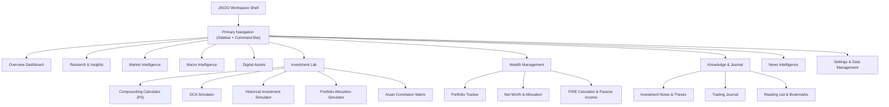

# Product Requirements Document (PRD)

## JISOO — Journal of Investment Strategy & Outlook

**Version:** 1.2  
**Status:** Ready for UI/UX Design & Phase 1 Implementation  
**Target Stack:** Vite 8 + Svelte 5 + TypeScript (Existing SPA Workspace)  
**Tagline:** _Understand Markets. Discover Opportunities._

---

## 1. Executive Summary

**JISOO (Journal of Investment Strategy & Outlook)** is an independent, frontend-first financial intelligence and investment research platform. It unifies live market monitoring, macroeconomic indicators, digital asset analytics, curated financial research, news intelligence, and interactive quantitative simulators into a single, distraction-free workspace.

JISOO combines the **clarity of a modern financial analytics product** with the **calm authority of a premium editorial publication**. Its interface is minimalist, spacious, data-focused, and enhanced by subtle, purposeful motion—avoiding generic admin dashboard clutter, heavy card nesting, and decorative noise.

### Key Architectural & Product Pillars

- **Frontend-First MVP:** Runs natively on the existing Vite + Svelte 5 + TypeScript SPA (`journal-of-investment-strategy`) with zero mandatory backend or database for MVP.
- **Local-First Persistence:** Uses `localStorage` for user preferences/watchlists and `IndexedDB` for structured research notes, cached API responses, portfolio entries, and simulation presets.
- **Priority Quantitative Tooling:** Ships the **Compounding Calculator** in Phase 1 as a flagship, mathematically transparent simulator inside the Investment Lab.
- **Backend-Ready Abstraction:** All data fetching and persistence sit behind typed service interfaces (`DataProvider`, `StorageRepository`) so a future backend or edge proxy can be introduced without rewriting UI components.

---

## 2. Product Vision & Objectives

### 2.1 Vision

Empower independent investors and analysts with an institutional-grade personal research terminal that bridges **macro context**, **asset-level intelligence**, **personal thesis journaling**, and **quantitative simulation**—while keeping their personal financial data private and local-first.

### 2.2 Product Objectives & Success Metrics

| Objective                            | Description                                                                             | Measurable Target (MVP / Post-MVP)                                                    |
| :----------------------------------- | :-------------------------------------------------------------------------------------- | :------------------------------------------------------------------------------------ |
| **O1: Unified Market Context**       | Surface crypto, equities, commodities, FX, yields, and sentiment in one scannable view. | Overview Dashboard loads cached/live snapshot in < 1.5s.                              |
| **O2: Quantitative Clarity**         | Provide transparent, instant-feedback investment calculators and simulators.            | Compounding Calculator updates in < 16ms (60fps) on input change.                     |
| **O3: Structured Research & Memory** | Enable thesis-driven investing via research archives and a local investment journal.    | 100% offline read/write support for notes, theses, and journal entries via IndexedDB. |
| **O4: Privacy-First Ownership**      | Keep personal portfolios, net worth, and notes strictly on the user's device.           | Zero PII transmitted to third-party servers; full JSON export/import support.         |

---

## 3. Target Users & Personas

| Persona                                         | Profile                                                                                        | Primary Needs                                                                         | Key Modules Used                                       |
| :---------------------------------------------- | :--------------------------------------------------------------------------------------------- | :------------------------------------------------------------------------------------ | :----------------------------------------------------- |
| **1. Independent Macro & Multi-Asset Investor** | Manages personal capital across equities, ETFs, gold, and crypto; reads central bank releases. | Cross-asset correlation, macro regime context (CPI, yields, DXY), thesis tracking.    | Overview, Macro Intelligence, Research, Investment Lab |
| **2. Long-Term Wealth Builder**                 | Focuses on consistent DCA, compounding, and financial independence (FIRE).                     | Visualizing compounding vs. contributions, DCA backtests, net worth & FIRE timelines. | Investment Lab (Compounding, DCA), Wealth Management   |
| **3. Digital Asset Analyst**                    | Evaluates L1/L2 tokens beyond price—supply schedules, FDV, unlocks, and sentiment.             | Tokenomics breakdown, market cap vs. FDV ratios, Fear & Greed, crypto news impact.    | Digital Assets, Market Intelligence, News Intelligence |

---

## 4. Brand Identity & Positioning

- **Positioning:** Independent financial intelligence & editorial research workspace—timeless, calm, and authoritative, positioned between a **premium financial publication** and a **modern institutional financial intelligence platform**.
- **Design Mantra:** _Less UI, More Information. Typography Before Decoration. Data Before Graphics. Purpose Before Effects. Clarity Before Complexity._
- **Tone of Voice:** Analytical, concise, objective, transparent about assumptions and uncertainty.
- **Visual & Experiential Direction:**
  - **Minimalist & Editorial:** Restrained visual hierarchy driven by typography, alignment, hairline dividers, and deliberate empty space rather than generic SaaS card grids.
  - **Neutral-First Palette (Light Mode Default + Optional Dark Mode):** Light Mode is the primary visual identity—clean white and warm/soft neutral backgrounds (`#F8FAFC`, `#FFFFFF`, `#F1F5F9`) with charcoal typography. An equally polished Dark Mode (`#0B0E14`, `#111620`, `#171D2B`) is available as an optional user-selectable theme.
  - **Restrained Accent & Semantic Color:** Institutional purple (`#7C3AED` / `#8B5CF6`) used sparingly for functional actions and active states; Emerald (`#059669` / `#10B981`) and Red (`#DC2626` / `#EF4444`) reserved strictly for meaningful financial movement.
  - **Purposeful Motion:** Short, natural, GPU-friendly transitions that clarify state changes without competing with financial data.
  - **Anti-AI Slop Discipline:** Zero decorative gradients, zero card-inside-card nesting, zero ornamental icons, zero floating blobs/illustrations, and zero generic template patterns. See Section 13.1 & 13.11 for mandatory enforcement rules.

---

## 5. Information Architecture



### Navigation Structure

- **Desktop (`>= 1280px`):** Compact, collapsible left rail (`220px` expanded / `56px` collapsed) + slim top utility bar (`52px` height) housing Global Search (`Cmd/Ctrl+K`), Market Sync status, Theme Toggle, and Quick Watchlist drawer trigger.
- **Tablet (`768px–1279px`):** Icon-first rail or slide-over navigation drawer + condensed utility bar.
- **Mobile (`< 768px`):** Clean top header + persistent bottom tab bar for top 5 destinations (`Overview`, `Markets`, `Lab`, `Research`, `More` sheet).

---

## 6. Product Modules & Features

### A. Overview Dashboard

Designed as a **premium financial intelligence homepage** rather than a crowded widget grid. Sections follow a strict editorial hierarchy using horizontal groupings, hairline dividers, and proportional emphasis:

1. **Page Header & Context:** Concise page title, current date/session context, and subtle sync status indicator.
2. **Compact Global Market Overview:** Slim, scannable horizontal strip for BTC, ETH, S&P 500, Nasdaq, Gold, Oil, DXY, and US 10Y Treasury Yield with tabular prices and 24h deltas.
3. **Selected Market Indicators:** High-signal metrics—Total Crypto Market Cap (with 24h % change) and Crypto Fear & Greed Index (clean arc/linear gauge `0–100` + label)—presented with restrained visual weight.
4. **Featured Research:** Editorial spotlight block highlighting the latest primary research brief (category, title, concise thesis excerpt, read time, outbound link).
5. **Latest Market Insights:** Clean, borderless list of the 5 most recent categorized news items with source, timestamp, sentiment/impact tag, and outbound link.
6. **Economic Events:** Compact chronological list of the next 3–5 upcoming high-impact macro releases (e.g., CPI, FOMC, NFP) with consensus/prior values.
7. **Watchlist:** Clean tabular summary of user-pinned assets showing symbol, price, 24h change, and minimal inline sparkline.

### B. Research & Insights

- **Coverage Categories:** Macroeconomic, Cryptocurrency, Equities/Companies, Industry & Tech Trends.
- **Structured Research Format:** Executive summary, Investment Thesis, Bullish Scenario, Bearish Scenario, Key Risks & Invalidation Triggers, Metadata (date, tags, related tickers).
- **Archive & Discovery:** Full-text search, category/tag filters, bookmarking (persisted locally).

### C. Market Intelligence

- **Asset Classes:** Cryptocurrencies, Stock Indices, Commodities, Forex, Bonds & Yields.
- **Interactive Charts:** Multi-timeframe historical price/yield charts (1D, 1W, 1M, 3M, 1Y, ALL).
- **Asset Comparison:** Overlay 2–4 normalized (% return) series on a single chart.
- **Performance & Watchlists:** Period return table (24h, 7d, 30d, YTD) and custom watchlists stored in `localStorage`/`IndexedDB`.

### D. Macro Intelligence

- **Core Indicators:** CPI & Core CPI, PCE, GDP Growth, Unemployment Rate, Federal Funds Rate, US Treasury Yields (2Y, 10Y, 10Y-2Y spread), DXY, Manufacturing/Services PMI.
- **Historical Charts:** Time-series visualizations with recession/rate-cycle annotations where available.
- **Market Implications:** Concise analytical notes explaining how indicator regimes typically affect equities, duration, USD, and digital assets.
- **Economic Calendar:** Filterable schedule by impact level (Low/Medium/High) and region.

### E. Digital Assets

- **Asset Profiles:** Deep-dive view per token (e.g., BTC, ETH, SOL).
- **Tokenomics & Valuation:** Market Cap, Fully Diluted Valuation (FDV), MC/FDV ratio, Circulating Supply, Max/Total Supply, 24h Volume, Volume/MCap ratio.
- **Supply & Ecosystem:** Token unlock schedule timeline (curated/static or API-fed), Sector classification (L1, L2, DeFi, Infra, Stablecoin), Ecosystem notes, and Side-by-Side Asset Comparison.

### F. Investment Lab _(Major Product Feature)_

1. **Compounding Calculator (P0 Priority):** Full specification in Section 9.
2. **DCA Simulator:** Asset selection, recurring amount, frequency (weekly/bi-weekly/monthly), historical date range; outputs Total Invested, Hypothetical Current Value, Total Units Accumulated, Average Cost Basis, and Return %.
3. **Historical Investment Simulator:** "What if I invested $X in [Asset] on [Date]?" lump-sum counterfactual with peak/trough drawdown stats.
4. **Portfolio Allocation Simulator:** Custom weight builder (must sum to 100%), asset class distribution, historical volatility/return proxy, and side-by-side scenario comparison (e.g., 60/40 vs. All-Weather vs. Crypto-Tilted).
5. **Asset Correlation:** Select 2–6 assets and timeframe (30d, 90d, 1Y, 3Y) to render a Pearson correlation matrix heatmap (-1.0 to +1.0).

### G. Wealth Management

- **Portfolio Tracker:** Manual holdings entry (asset, quantity, avg buy price, account/bucket); calculates live/cached valuation and unrealized P&L.
- **Net Worth Overview:** Assets vs. Liabilities summary and allocation breakdown.
- **Investment History:** Log of buys, sells, dividends, and staking rewards.
- **FIRE Calculator & Passive Income:** Current net worth, annual expenses, savings rate, safe withdrawal rate (e.g., 4% rule), expected real return -> projected FIRE number, years to FI, and wealth accumulation timeline chart.

### H. Knowledge & Journal

- **Financial Education:** Curated evergreen concepts (e.g., Duration Risk, Real Yields, Token Supply Inflation, Kelly Criterion).
- **Personal Investment Thesis & Notes:** Markdown-supported rich notes linked to specific assets or macro themes.
- **Trading Journal:** Entry/exit rationale, position sizing, emotional state, and post-trade review.
- **Reading List & Bookmarks:** Saved research articles, news items, and external links with tags.

### I. News Intelligence _(Cross-Cutting System)_

- **Verticals:** Financial, Crypto, Macro, Technology, Geopolitical.
- **Enrichment Pipeline:** Asset categorization, related ticker tagging, URL/title-similarity duplicate detection, Sentiment (`Bullish` / `Bearish` / `Neutral`), Market Impact (`Low` / `Medium` / `High`).
- **Attribution & Compliance:** Always display original source name, exact headline, publication timestamp, and outbound link to original article. Never store or republish full copyrighted article bodies.
- **Future Enhancement (Phase 5):** AI-generated 2-sentence executive summaries.

---

## 7. Functional & Non-Functional Requirements

### 7.1 Functional Requirements

| ID        | Module         | Requirement                                                                                              | Priority | Dependencies                 | Data Requirements                               |
| :-------- | :------------- | :------------------------------------------------------------------------------------------------------- | :------- | :--------------------------- | :---------------------------------------------- |
| **FR-01** | Shell          | App provides responsive navigation across all 8 modules + theme toggle (Light default / Dark optional).  | **P0**   | Design System                | `localStorage` (`jisoo:theme`, `navCollapsed`)  |
| **FR-02** | Overview       | Display live/cached BTC, ETH, Crypto MCap, and Fear & Greed Index with 24h delta.                        | **P0**   | CoinGecko / Alternative.me   | Price, 24h %, MCap, F&G value (0–100)           |
| **FR-03** | Overview       | Display macro/tradfi snapshot (S&P 500, Nasdaq, Gold, Oil, DXY, 10Y Yield) via API or curated fallback.  | **P0**   | Market Data Adapter          | Symbol, price/value, % change, `asOf` timestamp |
| **FR-04** | Overview       | Watchlist summary widget allowing quick add/remove and click-through to asset detail.                    | **P0**   | `localStorage` / Market API  | Watchlist IDs, live/cached quotes               |
| **FR-05** | Lab            | **Compounding Calculator** with real-time calculation, validation, zero-return support, and dual charts. | **P0**   | None (100% local math)       | Inputs + schedule array (see Sec. 9)            |
| **FR-06** | Research       | List, search, filter, and read structured research briefs with Bull/Bear/Risk sections & bookmarks.      | **P1**   | IndexedDB                    | Curated JSON/Markdown briefs + bookmark IDs     |
| **FR-07** | News           | Aggregate permitted RSS/news feeds with deduplication, category/impact tags, and outbound links.         | **P1**   | News Adapter / CORS Proxy    | Headline, source, URL, publishedAt, tags        |
| **FR-08** | Macro          | Display key macro indicators (CPI, PCE, GDP, Unemployment, Fed Funds, Yields, DXY, PMI) + calendar.      | **P1**   | FRED / World Bank / Static   | Time-series `{date, value}[]`, calendar events  |
| **FR-09** | Digital Assets | Token detail pages with MC, FDV, supply metrics, volume, sector, and 2-asset comparison.                 | **P1**   | CoinGecko API                | Coin metadata, market data, supply fields       |
| **FR-10** | Markets        | Multi-asset historical charts and normalized (%) multi-asset comparison view.                            | **P1**   | CoinGecko / Binance / TradFi | OHLCV or daily close series                     |
| **FR-11** | Lab            | DCA Simulator, Historical Lump-Sum Simulator, Portfolio Allocation, and Correlation Matrix.              | **P2**   | Historical Price Series      | Daily historical prices (1Y–5Y+)                |
| **FR-12** | Wealth         | Local Portfolio Tracker, Net Worth summary, FIRE Calculator, and Wealth Accumulation chart.              | **P2**   | IndexedDB + Price API        | Holdings, liabilities, cashflow inputs          |
| **FR-13** | Journal        | Local Markdown Notes, Trading Journal, Reading List, and full-workspace JSON Export/Import.              | **P2**   | IndexedDB                    | Notes, journal entries, schema version          |

### 7.2 Non-Functional Requirements

| Category            | Requirement                                                                                                                                                                                                                                               |
| :------------------ | :-------------------------------------------------------------------------------------------------------------------------------------------------------------------------------------------------------------------------------------------------------- |
| **Performance**     | Initial bundle < 250 KB gzipped (excluding lazy-loaded chart modules); Compounding Calculator recalculation < 16ms; GPU-composited animations (`transform`/`opacity`) at 60fps; Lighthouse Performance >= 90.                                             |
| **Accessibility**   | WCAG 2.1 AA contrast compliance in both Dark and Light modes; full keyboard navigation (`Tab`, `Esc`, `Cmd/Ctrl+K`); `aria-label` on all charts/gauges; tabular numerals (`font-variant-numeric: tabular-nums`); strict `prefers-reduced-motion` support. |
| **Security**        | Zero private API keys in `VITE_*` frontend env vars; strict CSP headers recommendation; sanitize any rendered Markdown/HTML (e.g., DOMPurify) to prevent XSS in Research/Journal.                                                                         |
| **Privacy**         | 100% local storage for personal holdings, journal entries, and simulator inputs; no third-party analytics tracking by default.                                                                                                                            |
| **Reliability**     | Stale-while-revalidate caching in IndexedDB; graceful degradation to last-known cached data with explicit `"Last updated: ..."` badge when offline or rate-limited.                                                                                       |
| **Responsive**      | Fluid layouts across Desktop (`>= 1280px`), Tablet (`768px–1279px`), and Mobile (`< 768px`); horizontal scroll or stacked cards for dense tables on mobile.                                                                                               |
| **Maintainability** | Strict TypeScript (`svelte-check` + `tsc` zero errors); feature-based module boundaries; unit tests for all financial math engines (Compounding, DCA, Correlation, FIRE).                                                                                 |

---

## 8. User Stories & Acceptance Criteria

### US-01: Market Snapshot & Graceful Fallback (Overview)

> **As an** investor, **I want** to see key crypto, equity, commodity, and macro indicators immediately upon opening JISOO, **so that** I can assess market conditions in under 10 seconds.

- **Given** the user opens the Overview Dashboard with an active internet connection
- **When** market APIs respond within timeout (5s)
- **Then** BTC, ETH, Crypto Market Cap, Fear & Greed Index, and macro snapshot tiles render with live values, emerald/red 24h deltas, and a fresh sync timestamp.
- **Given** an external API is rate-limited (HTTP 429) or unreachable
- **When** the Overview Dashboard loads
- **Then** the UI displays the most recent cached values from IndexedDB alongside a subtle `"Cached · [Timestamp]"` indicator and a manual retry action—never a blank crash screen.

### US-02: Compounding Calculator Real-Time Modeling (Investment Lab)

> **As a** long-term investor, **I want** to adjust my initial capital, monthly contribution, return rate, duration, compounding frequency, and contribution timing, **so that** I can immediately see how compounding affects my projected wealth.

- **Given** the user is on the Compounding Calculator
- **When** any valid input changes (e.g., Monthly Contribution changed from `$500` to `$1,000`)
- **Then** all 6 summary metrics, the year-by-year growth chart, and the Principal vs. Compounded Returns breakdown update immediately without a page reload or "Calculate" button click.
- **Given** the user enters `0%` as the Annual Expected Return
- **When** the calculation runs
- **Then** no division-by-zero or `NaN` error occurs; Estimated Investment Profit equals `$0.00`, Effective Annual Return equals `0.00%`, and Final Projected Balance equals `Initial Investment + Total Contributions`.
- **Given** the user enters a negative initial investment or a duration > 100 years
- **When** input validation runs
- **Then** an inline validation message explains the allowed range and prevents invalid chart rendering.

### US-03: Research Filtering & Local Bookmarking (Research & Insights)

> **As a** researcher, **I want** to filter research briefs by asset class and bookmark key theses, **so that** I can revisit high-conviction ideas offline.

- **Given** the user is in Research & Insights
- **When** they select `"Macroeconomic"` and type `"yield"` in the search bar
- **Then** only matching macroeconomic briefs are displayed, preserving Bull/Bear/Risk structure on detail view.
- **When** the user clicks Bookmark on a brief
- **Then** the bookmark state persists in IndexedDB across page reloads and appears in Knowledge & Journal -> Bookmarks.

### US-04: News Attribution & Deduplication (News Intelligence)

> **As a** reader, **I want** categorized financial news without duplicate stories or missing sources, **so that** I can scan market-moving events efficiently.

- **Given** multiple feeds report the same headline/URL
- **When** the news aggregator processes the items
- **Then** duplicates are collapsed, and every displayed item shows original source, headline, publication date, sentiment/impact badge, and an outbound link (`rel="noopener noreferrer"`) to the publisher.

### US-05: Local Portfolio & JSON Export (Wealth Management)

> **As a** privacy-conscious user, **I want** to track my holdings locally and export/import my data as JSON, **so that** I never lose my records or expose them to a cloud server.

- **Given** the user has portfolio holdings and journal notes in IndexedDB
- **When** they click `"Export Workspace Data"`
- **Then** a versioned `.json` file downloads containing all local stores; re-importing that file on a clean browser restores the exact state after schema validation.

---

## 9. Compounding Calculator Specification _(Priority Feature)_

### 9.1 Inputs & Validation Rules

| Input Field                | Type             | Default   | Min | Max           | Step  | Validation & Behavior                                                                    |
| :------------------------- | :--------------- | :-------- | :-- | :------------ | :---- | :--------------------------------------------------------------------------------------- |
| **Initial Investment**     | Currency (`$`)   | `10,000`  | `0` | `100,000,000` | `100` | Reject negative values; allow `0` if monthly contribution > 0.                           |
| **Monthly Contribution**   | Currency (`$`)   | `500`     | `0` | `10,000,000`  | `50`  | Reject negative values; allow `0` (pure lump-sum mode).                                  |
| **Annual Expected Return** | Percentage (`%`) | `8.0`     | `0` | `100`         | `0.1` | Support `0%` cleanly; warn (non-blocking) if `> 25%` as aggressive assumption.           |
| **Investment Duration**    | Integer (Years)  | `20`      | `1` | `60`          | `1`   | Must be integer `>= 1`; decimals rounded or rejected with inline hint.                   |
| **Compounding Frequency**  | Enum             | `monthly` | —   | —             | —     | Options: `daily` ($n=365$), `monthly` ($n=12$), `quarterly` ($n=4$), `annually` ($n=1$). |
| **Contribution Timing**    | Enum             | `end`     | —   | —             | —     | `beginning` (Annuity Due) or `end` (Ordinary Annuity) of each month.                     |

### 9.2 Mathematical Specification

Let:

- $P_0$ = Initial Investment
- $C$ = Monthly Contribution
- $r$ = Annual nominal return rate as decimal (e.g., `8%` $\rightarrow 0.08$)
- $T$ = Duration in years ($12T$ total months)
- $n$ = Compounding periods per year ($365, 12, 4, 1$)

**1. Effective Annual Return ($r_{\text{eff}}$):**
$$r_{\text{eff}} = \left(1 + \frac{r}{n}\right)^n - 1$$
_(If $r = 0$, then $r_{\text{eff}} = 0$.)\_

**2. Equivalent Monthly Growth Rate ($r_m$):**
To ensure exact consistency between monthly cashflows and any compounding frequency $n \in \{365, 12, 4, 1\}$:
$$r_m = \left(1 + \frac{r}{n}\right)^{n/12} - 1$$
_(Note: When $n = 12$, $r_m = r / 12$. When $r = 0$, $r_m = 0$.)_

**3. Month-by-Month Iterative Simulation ($m = 1 \dots 12T$):**
Iterative monthly simulation guarantees exact alignment between summary outputs, the annual breakdown table, and the growth chart:

- **Beginning of month (`timing === 'beginning'`):**
  $$B_m = (B_{m-1} + C) \cdot (1 + r_m)$$
- **End of month (`timing === 'end'`):**
  $$B_m = B_{m-1} \cdot (1 + r_m) + C$$
  Where $B_0 = P_0$.

### 9.3 Outputs & Formatting

| Output Metric                   | Formula                     | Formatting                                        |
| :------------------------------ | :-------------------------- | :------------------------------------------------ |
| **Total Initial Investment**    | $P_0$                       | Currency (`$10,000.00` or compact `$10,000`)      |
| **Total Contributions**         | $C \times 12T$              | Currency                                          |
| **Total Invested Capital**      | $P_0 + (C \times 12T)$      | Currency                                          |
| **Estimated Investment Profit** | $B_{12T} - (P_0 + 12TC)$    | Currency (Emerald if $> 0$)                       |
| **Final Projected Balance**     | $B_{12T}$                   | Hero Currency display                             |
| **Effective Annual Return**     | $r_{\text{eff}} \times 100$ | Percentage (`8.30%` for 8% daily, `8.00%` annual) |

### 9.4 Visualizations & Methodology Disclosure

1. **Growth Chart Over Time (Stacked Area / Line):** X-axis = Year `0` to `T`; Y-axis = Balance (`$`). Three series: _Initial Investment_ (slate), _Cumulative Contributions_ (muted purple), _Compounded Returns_ (emerald/bright purple). Interactive hover tooltip showing exact year breakdown.
2. **Principal vs. Compounded Returns Breakdown:** Horizontal stacked bar or donut showing % share of Final Balance attributable to Invested Capital vs. Compounded Growth.
3. **Methodology & Disclaimer Accordion:** Always accessible below the calculator explaining $r_{\text{eff}}$, $r_m$, beginning vs. end-of-month timing, and explicitly stating: _"Projections are hypothetical mathematical estimates based on constant assumed rates of return. They do not account for inflation, taxes, fees, or market volatility, and do not guarantee future performance."_

---

## 10. Data Sources & Integrations

> **Critical Architectural Constraint:** Browser SPAs are subject to **CORS** and **public client-side exposure**. Private API keys must **never** be bundled into `VITE_*` environment variables.

| Provider                  | Domain                                              | Auth                          | Rate Limits                  | Browser CORS                       | Licensing / Attribution & Notes                                                                                                                                                                                     |
| :------------------------ | :-------------------------------------------------- | :---------------------------- | :--------------------------- | :--------------------------------- | :------------------------------------------------------------------------------------------------------------------------------------------------------------------------------------------------------------------ |
| **CoinGecko API**         | Crypto prices, MCap, FDV, supply, historical charts | None (Public) or Demo Key     | ~10–30 req/min (Public/Demo) | **Yes**                            | Requires _"Powered by CoinGecko"_ attribution. Aggressive client caching (60s–5m TTL) required to avoid HTTP 429.                                                                                                   |
| **Binance Public API**    | Spot prices, 24h ticker, OHLCV `/api/v3/klines`     | None (Public endpoints)       | 6,000 weight/min             | **Yes**                            | Geo-restricted in some jurisdictions (e.g., US). Use as secondary/fallback for crypto OHLCV.                                                                                                                        |
| **Coinbase Exchange API** | Spot ticker, candles `/products/{id}/candles`       | None (Public endpoints)       | ~10 req/sec                  | **Yes**                            | Reliable fallback for USD pairs (BTC-USD, ETH-USD).                                                                                                                                                                 |
| **Alternative.me**        | Crypto Fear & Greed Index (`/fng/`)                 | None                          | Generous (daily update)      | **Yes**                            | Free for non-commercial/personal use with attribution. Cache for 1–6 hours.                                                                                                                                         |
| **FRED API**              | US Macro (CPI, PCE, GDP, Fed Funds, 10Y/2Y Yields)  | **API Key required**          | 120 req/min                  | **No** (Blocks browser CORS)       | **MVP Strategy:** Do _not_ embed FRED key in frontend. Support either (a) static/build-time JSON snapshots refreshed via script, or (b) optional user-configured local proxy/key in Settings. Attribution required. |
| **World Bank API**        | Global GDP, inflation, macro indicators             | None                          | Generous                     | **Yes**                            | CC BY 4.0 license. Suitable for annual/quarterly global macro context.                                                                                                                                              |
| **IMF Data API**          | Global economic outlook & macro series              | None                          | Moderate (strict throttling) | **Limited / Unreliable**           | Better suited for pre-fetched static snapshots than live browser polling.                                                                                                                                           |
| **RSS / News APIs**       | Financial, Crypto, Macro news                       | Varies (RSS: None; APIs: Key) | Varies                       | **No** (Most RSS feeds block CORS) | **MVP Strategy:** Ship curated/static feed snapshots or allow an optional lightweight CORS/RSS-to-JSON edge proxy. Always preserve source, headline, date, and URL; never scrape full bodies.                       |

---

## 11. Technical Architecture

### 11.1 Existing Project Assessment

Based on inspection of `journal-of-investment-strategy`:

- **Build Tool:** Vite `^8.3.6` (`vite.config.ts`)
- **UI Framework:** Svelte `^5.57.3` (`@sveltejs/vite-plugin-svelte` `^7.3.1`), mounted via `mount(App, ...)` in `src/main.ts`.
- **TypeScript:** `~6.0.3` with `svelte-check` `^4.7.7` and `tsconfig.app.json` (`target: "es2023"`).
- **Package Manager:** `bun` (`bun.lock` present).
- **Current State:** Fresh template (`src/App.svelte`, `src/app.css`, `src/lib/Counter.svelte`). No router, charting library, or icon library installed yet.

### 11.2 Recommended Dependencies (Minimal, High-Value Only)

1. `lucide-svelte` — Clean, institutional SVG icon set (eliminates Unicode/emoji icons).
2. `lightweight-charts` (TradingView) _or_ `chart.js` — `lightweight-charts` for financial price/yield time-series; lightweight custom SVG or `chart.js` for Compounding stacked area & correlation heatmaps.
3. `idb` (~1.2 KB) — Tiny typed Promise wrapper around IndexedDB.
4. `dompurify` (Phase 2+) — Safe HTML/Markdown rendering for Research & Journal.
5. _Routing:_ Lightweight hash/history SPA router (e.g., `@mateothegreat/svelte5-router` or a 60-line custom Svelte 5 rune-based router) rather than migrating to SvelteKit.
6. _Animation / Motion:_ **No external animation library required.** Native CSS transitions/keyframes combined with Svelte 5's built-in `svelte/transition`, `svelte/animate`, and `svelte/motion` (`Tween`, `Spring`) are sufficient for all page transitions, numeric interpolation, drawers, and micro-interactions with zero extra bundle overhead.

### 11.3 Feature-Based Folder Structure

```text
src/
├── app.css                     # Design tokens (CSS variables), typography, dark/light themes
├── main.ts                     # Existing mount entrypoint
├── App.svelte                  # Workspace shell (Sidebar, Topbar, Router outlet)
├── core/
│   ├── router/                 # Lightweight SPA route definitions & navigation state
│   ├── storage/                # localStorage & IndexedDB (idb) repositories + export/import
│   ├── api/                    # Fetch wrapper, rate-limit backoff, TTL cache, provider interfaces
│   └── utils/                  # Currency/percent formatters, date helpers, validators
├── design-system/              # Reusable UI primitives (Button, Input, Select, Badge, DataTable, Modal, EmptyState)
└── features/
    ├── overview/               # Dashboard, market snapshot strip, watchlist widget
    ├── research/               # Research briefs, thesis viewer, bookmarks
    ├── markets/                # Multi-asset explorer, comparison charts
    ├── macro/                  # Macro indicators, yields, economic calendar
    ├── digital-assets/         # Token profiles, tokenomics, unlocks
    ├── investment-lab/         # Compounding Calculator (P0), DCA, Historical, Allocation, Correlation
    │   └── compounding/        # Pure TS math engine + unit tests + UI components
    ├── wealth/                 # Portfolio tracker, net worth, FIRE calculator
    ├── journal/                # Markdown notes, trading journal, reading list
    └── news/                   # News feed, deduplication, sentiment/impact badges
```

### 11.4 Data Fetching, Caching & Error Handling

- **Stale-While-Revalidate (SWR):** Check IndexedDB cache first. If fresh (`now < expiresAt`), return immediately. If stale, return cached data immediately with `isStale: true` and trigger background refresh.
- **Rate-Limit Protection:** Exponential backoff on HTTP 429; deduplicate concurrent identical in-flight requests.
- **UI States:** Every async widget must implement 4 explicit states: `Loading` (skeleton), `Loaded`, `Empty` (actionable CTA), and `Error/Offline` (cached fallback or retry button).

---

## 12. Local Data & Storage Design

### 12.1 `localStorage` (Lightweight Preferences & UI State)

Namespaced under `jisoo:*`:

- `jisoo:theme`: `'light' | 'dark'` (defaults to `'light'` when unset; OS `prefers-color-scheme` does not override first-time default)
- `jisoo:currency`: `'USD' | 'EUR' | 'GBP'` (display preference)
- `jisoo:sidebarCollapsed`: `boolean`
- `jisoo:watchlist`: `string[]` (e.g., `['bitcoin', 'ethereum', 'SPX', 'XAU']`)

### 12.2 `IndexedDB` (`jisoo-db`, v1) Object Stores

| Store Name           | Key Path       | Indexes                         | Contents                                                                                    |
| :------------------- | :------------- | :------------------------------ | :------------------------------------------------------------------------------------------ |
| `api_cache`          | `key` (string) | `expiresAt`                     | `{ key, data, fetchedAt, expiresAt, source }`                                               |
| `research_bookmarks` | `id` (string)  | `savedAt`                       | `{ id, title, category, savedAt }`                                                          |
| `journal_entries`    | `id` (uuid)    | `type`, `updatedAt`, `assetTag` | `{ id, type: 'note' \| 'thesis' \| 'trade', title, contentMd, tags, createdAt, updatedAt }` |
| `portfolio_holdings` | `id` (uuid)    | `assetId`, `bucket`             | `{ id, symbol, assetClass, quantity, avgCost, bucket, updatedAt }`                          |
| `lab_presets`        | `id` (uuid)    | `toolType`                      | Saved Compounding, DCA, and Allocation scenarios                                            |

### 12.3 Export / Import Schema

Single versioned JSON envelope:

```json
{
  "schemaVersion": 1,
  "exportedAt": "2026-11-16T10:30:00Z",
  "preferences": { "theme": "light", "watchlist": ["bitcoin", "ethereum"] },
  "stores": {
    "research_bookmarks": [],
    "journal_entries": [],
    "portfolio_holdings": [],
    "lab_presets": []
  }
}
```

---

## 13. UI/UX Design System & Interaction Guidelines

JISOO's interface is governed by a **minimalist, editorial-first design system** built on CSS custom properties (`src/app.css`). Every visual element and animation must serve clarity, hierarchy, or feedback.

### 13.1 Core Philosophy & Anti-AI Slop Rules

JISOO must look intentionally designed—never like a generic AI-generated SaaS dashboard. Every element must earn its place: **if an element does not improve information, usability, hierarchy, or interaction, remove it.**

- **Core Tenets:** _Less UI, More Information · Typography Before Decoration · Data Before Graphics · Purpose Before Effects · Clarity Before Complexity._
- **A. Selective Iconography:** Do **not** place icons beside every heading, inside every card, or in navigation items where typography and spacing are clearer. Never use Unicode emojis as UI icons. Use `lucide-svelte` selectively only for recognizable functional controls (Search, Settings, Theme toggle, Navigation controls, External links, Expand/Collapse, User actions) at restrained, consistent sizes (`16px–20px`).
- **B. Card Restraint:** Do **not** wrap every section in a card. Avoid nested cards, repetitive rounded-rectangle grids, heavy shadows, and unnecessary borders. Prefer editorial columns, open sections, horizontal `1px` dividers, data tables, minimal metric rows, and asymmetric layouts. Use boxed containers only when grouping or interaction genuinely requires them.
- **C. No Decorative Gradients:** Use solid neutral surfaces as the foundation. Do **not** use purple hero gradients, gradient heading text, glowing backgrounds, gradient borders, overlapping radial gradients, or glassmorphism bloat. Gradients are permitted only when functionally justified (e.g., subtle area-chart fill).
- **D. Avoid Generic AI Patterns:** Reject 3-column feature-card templates, repeated icon+heading+paragraph blocks, floating decorative circles/blobs, excessive pill badges, decorative/fake charts, arbitrary percentages, and repetitive section compositions.
- **E. Minimal Visual Noise:** Do not introduce competing accent colors, redundant badges, extra borders, or decorative illustrations. Differentiate primary insights from secondary information through typography, weight, and whitespace.

### 13.2 Semantic Theme Tokens (Light Default & Optional Dark)

All components must reference semantic CSS custom properties rather than hardcoded hex values. **Light Mode** is the default visual identity; **Dark Mode** is a purposefully calibrated alternative (not a naive color inversion).

| Category         | Token                                                | Light Mode (Default)                   | Dark Mode (Optional)                   | Usage                                                         |
| :--------------- | :--------------------------------------------------- | :------------------------------------- | :------------------------------------- | :------------------------------------------------------------ |
| **Background**   | `--bg-background`                                    | `#F8FAFC`                              | `#0B0E14`                              | Primary canvas (soft neutral in light, deep charcoal in dark) |
| **Foreground**   | `--fg-primary`                                       | `#0F172A`                              | `#F1F5F9`                              | Headings, primary financial values, body text                 |
| **Surface**      | `--bg-surface`                                       | `#FFFFFF`                              | `#111620`                              | Panels, tables, drawers, modal bodies                         |
| **Elevated**     | `--bg-elevated`                                      | `#F1F5F9`                              | `#171D2B`                              | Hover rows, active tabs, popovers                             |
| **Muted**        | `--bg-muted`                                         | `#F3F4F6`                              | `#141925`                              | Secondary containers, table headers, code/tag pills           |
| **Primary**      | `--primary`                                          | `#7C3AED`                              | `#8B5CF6`                              | Primary buttons, active indicators                            |
| **Primary Text** | `--primary-foreground`                               | `#FFFFFF`                              | `#FFFFFF`                              | Text/icons on `--primary` buttons                             |
| **Secondary**    | `--fg-secondary`                                     | `#475569`                              | `#94A3B8`                              | Labels, descriptions, axis ticks                              |
| **Muted Text**   | `--fg-muted`                                         | `#94A3B8`                              | `#64748B`                              | Timestamps, placeholders, disabled states                     |
| **Accent**       | `--accent-subtle`                                    | `rgba(124, 58, 237, 0.08)`             | `rgba(139, 92, 246, 0.12)`             | Active nav tint, selected row highlight                       |
| **Border**       | `--border`                                           | `#E2E8F0`                              | `#1E2636`                              | Hairline dividers, table rules, subtle panel edges            |
| **Input**        | `--input-bg` / `--input-border`                      | `#FFFFFF` / `#CBD5E1`                  | `#0F141E` / `#2D374B`                  | Form controls, search bars, selects                           |
| **Ring**         | `--ring`                                             | `rgba(124, 58, 237, 0.45)`             | `rgba(139, 92, 246, 0.50)`             | Keyboard `:focus-visible` outline                             |
| **Positive**     | `--positive` / `--positive-subtle`                   | `#059669` / `rgba(5, 150, 105, 0.10)`  | `#10B981` / `rgba(16, 185, 129, 0.12)` | Gains, bullish badges, positive deltas                        |
| **Negative**     | `--negative` / `--negative-subtle`                   | `#DC2626` / `rgba(220, 38, 38, 0.10)`  | `#EF4444` / `rgba(239, 68, 68, 0.12)`  | Losses, bearish badges, validation errors                     |
| **Warning**      | `--warning` / `--warning-subtle`                     | `#D97706` / `rgba(217, 119, 6, 0.10)`  | `#F59E0B` / `rgba(245, 158, 11, 0.12)` | Caution, neutral sentiment, stale cache notice                |
| **Chart Grid**   | `--chart-grid`                                       | `rgba(15, 23, 42, 0.06)`               | `rgba(241, 245, 249, 0.06)`            | Subtle horizontal chart grid lines                            |
| **Chart Axis**   | `--chart-axis`                                       | `#64748B`                              | `#94A3B8`                              | X/Y axis labels and crosshair guides                          |
| **Chart Series** | `--chart-series-1` / `2` / `3`                       | `#7C3AED` / `#059669` / `#64748B`      | `#8B5CF6` / `#10B981` / `#94A3B8`      | Primary, secondary, and baseline series                       |
| **Tooltip**      | `--tooltip-bg` / `--tooltip-fg` / `--tooltip-border` | `#0F172A` / `#F8FAFC` / `#1E293B`      | `#1E2636` / `#F1F5F9` / `#2D374B`      | Floating tooltips & chart hover callouts                      |
| **Navigation**   | `--nav-bg` / `--nav-active-bg`                       | `#FFFFFF` / `rgba(124, 58, 237, 0.08)` | `#0E121B` / `rgba(139, 92, 246, 0.14)` | Sidebar/bottom-bar surface and active item fill               |

### 13.3 Theme Strategy & Interaction

- **Default Initialization:** First-time visitors always initialize in **Light Mode** (`data-theme="light"`). Do **not** auto-switch to Dark Mode based on OS `prefers-color-scheme` when no saved preference exists.
- **Persistence & Restoration:** User selection is persisted in `localStorage` under `jisoo:theme` (`'light' | 'dark'`). On page load, an inline `<head>` script (or pre-mount initializer) reads `jisoo:theme` and sets `data-theme` on `<html>` before first paint to prevent any flash of unstyled/wrong theme.
- **Toggle Placement & Accessibility:** Accessible from the top utility bar on all pages and in Settings, using a clear icon + `aria-label` (e.g., `"Switch to dark mode"` / `"Switch to light mode"`) and `aria-pressed` state.
- **Subtle Theme Transition:** Switching themes applies a brief `150ms` `background-color` and `border-color` transition on root layout surfaces—avoiding jarring full-screen fades or animating every text node.
- **Full Component & Chart Reactivity:** All modules, tables, dialogs, tooltips, and interactive charts (`lightweight-charts` / SVG) must subscribe to the active theme state and immediately update backgrounds, grid lines, axis labels, and tooltip contrast.

### 13.4 Typography-First System & Scale

Typography is the primary structural element of JISOO—replacing decorative icons and heavy card borders to establish hierarchy.

- **Font Families:**
  - `--font-sans`: `'Inter', -apple-system, BlinkMacSystemFont, sans-serif` (UI, navigation, tables, metrics, headings)
  - `--font-serif`: `'Newsreader', 'Source Serif 4', Georgia, serif` (optional for long-form Research thesis body text)
  - `--font-mono`: `'JetBrains Mono', ui-monospace, monospace` (tickers, numeric inputs, code)
- **Numeric & Typographic Discipline:** Apply `font-variant-numeric: tabular-nums` to all prices, percentages, timestamps, and table columns. Use tight tracking (`-0.015em` to `-0.02em`) on larger headings, neutral tracking (`0`) on body text, and subtle positive tracking (`+0.02em`) on uppercase/label metadata. Never use oversized headings everywhere—reserve large scale strictly for meaningful editorial hierarchy.

| Token               | Role                   | Size / Line-Height | Weight | Usage                                                   |
| :------------------ | :--------------------- | :----------------- | :----- | :------------------------------------------------------ |
| `--text-hero`       | Hero / Editorial Lead  | `28px / 34px`      | `600`  | Primary calculator hero output, featured research title |
| `--text-page-title` | Page Title             | `22px / 30px`      | `600`  | Module page title (compact, never oversized)            |
| `--text-section`    | Section Heading        | `16px / 24px`      | `600`  | Section headings, article preview headlines             |
| `--text-kpi`        | Financial Metrics      | `18px / 24px`      | `500`  | Market snapshot prices, summary stats (`tabular-nums`)  |
| `--text-body`       | Body Text              | `14px / 22px`      | `400`  | Editorial summaries, descriptions, table cells          |
| `--text-nav`        | Navigation & Links     | `13px / 20px`      | `500`  | Sidebar items, tabs, inline text actions                |
| `--text-label`      | Labels & Table Headers | `12px / 16px`      | `500`  | Form labels, table column headers, status tags          |
| `--text-meta`       | Metadata & Captions    | `11px / 14px`      | `400`  | Timestamps, sources, chart axis ticks, footnotes        |

### 13.5 Editorial Layout, Spacing, Radius & Elevation

- **Spacing Scale:** `4px` base unit (`--space-1: 4px`, `--space-2: 8px`, `--space-3: 12px`, `--space-4: 16px`, `--space-6: 24px`, `--space-8: 32px`, `--space-12: 48px`).
- **Editorial Composition:** Adopt an editorial layout rather than a repetitive SaaS dashboard grid. Empty space is a deliberate design element—do **not** fill every available pixel with widgets. Vary composition, typography, and density across sections; use controlled content width (`1360px` max centered), generous section gaps (`32px–48px`), balanced text-to-data ratios, and intentional asymmetry.
- **Navigation Constraints:** Compact desktop sidebar (`220px` expanded / `56px` collapsed); top utility bar `52px`.
- **Border Radius:** Restrained, sharp-modern radii (`--radius-sm: 4px` for badges/inputs, `--radius-md: 6px` for buttons/dropdowns, `--radius-lg: 8px` for panels/modals). Avoid overly rounded `16px+` containers.
- **Elevation:** Flat hierarchy using `--border` (`1px solid`). Reserve subtle theme-aware overlay shadows (`--shadow-overlay`: `0 8px 24px rgba(15, 23, 42, 0.08)` in Light Mode; `0 8px 24px rgba(0, 0, 0, 0.32)` in Dark Mode) strictly for floating overlays (modals, command palette, tooltips, dropdowns).

### 13.6 Motion with Purpose

Motion in JISOO is **calm, purposeful, and GPU-composited** (`transform` and `opacity` only), powered by native CSS transitions and Svelte 5 built-in `svelte/transition` / `svelte/motion`—with zero external animation libraries.

- **Motion Tokens:**
  - `--ease-standard`: `cubic-bezier(0.22, 1, 0.36, 1)` (smooth deceleration, zero bounce)
  - `--ease-exit`: `cubic-bezier(0.4, 0, 1, 1)`
  - `--duration-fast`: `120ms` (button press, hover states, focus rings, tooltip appear)
  - `--duration-normal`: `200ms` (dropdowns, tab indicator slide, numeric value transitions, skeleton fade)
  - `--duration-panel`: `260ms` (route/page crossfade, modal/drawer slide-in)
- **Permitted Patterns:** Subtle `180ms` page/section transitions, restrained hover & button press (`scale(0.985)`), smooth numeric interpolation (`Tween` over `200ms` on calculator outputs) and brief `600ms` positive/negative tick tint, smooth tab/dropdown/modal transitions, theme surface transition (`150ms`), and low-contrast loading skeletons.
- **Explicitly Prohibited:** Parallax scrolling, constantly moving/ambient elements, floating decorative objects, bouncing, spinning icons, excessive stagger animations, animating every component simultaneously, and long transitions (`> 300ms`).
- **Reduced Motion:** Strictly honor `@media (prefers-reduced-motion: reduce)` across all CSS transitions and Svelte motion helpers—reducing durations to `0ms` or instant state swaps. Motion must never compete with financial data or reduce readability.

### 13.7 Minimalist Component Design Rules

| Component                    | Design Direction                                                                                                                                                                         | Anti-Patterns to Avoid                                                                     |
| :--------------------------- | :--------------------------------------------------------------------------------------------------------------------------------------------------------------------------------------- | :----------------------------------------------------------------------------------------- |
| **Navigation**               | Compact left rail (`--nav-bg`) prioritizing clear text labels; selective `lucide-svelte` icons only where they aid scanning; `Cmd/Ctrl+K` command bar.                                   | Wide sidebars (`> 240px`), icon-beside-everything clutter, emoji icons, nested accordions. |
| **Buttons**                  | Strict 3-tier hierarchy: **Primary** (`--primary` solid fill, max 1 per view), **Secondary** (`1px` `--border` outline), **Tertiary / Text** (subtle hover).                             | Styling every action as a prominent filled button; pill-shaped bloat.                      |
| **Links**                    | Visually recognizable as links (clear underline on hover or distinct `--primary` / `--fg-primary` weight with external-link icon when outbound).                                         | Disguising links as unlabeled plain text or oversized buttons.                             |
| **Dashboard Sections**       | Editorial bands separated by `1px` `--border` hairlines and whitespace; asymmetric hierarchy.                                                                                            | Uniform grid of identical boxed cards; cards nested inside cards.                          |
| **Metric Displays**          | Clean label above tabular value + inline `--positive`/`--negative` delta.                                                                                                                | Oversized KPI tiles with decorative background icons or glow effects.                      |
| **Financial Data Tables**    | Sticky compact headers (`36px` row height), right-aligned `tabular-nums`, subtle `--bg-elevated` row hover, hairline row dividers.                                                       | Heavy zebra striping, thick cell borders, cramped multi-line cells.                        |
| **Article Previews**         | Borderless or hairline-separated editorial rows: category label, headline, 2-line thesis summary, date/read-time.                                                                        | Stock-photo thumbnails, gradient overlays, cluttered tag clouds.                           |
| **News Items**               | Compact scannable feed: Source + Timestamp + Impact indicator + Headline + Outbound link.                                                                                                | Full-article embeds, loud colored banners, duplicate entries.                              |
| **Inputs & Dropdowns**       | `36px–40px` height, `--input-bg` + `--input-border`, `--ring` focus outline (`2px`), inline validation in `--negative`.                                                                  | Floating labels that jump, heavy inner shadows, decorative icons inside every field.       |
| **Tabs, Dialogs & Tooltips** | Border-bottom underline tabs; centered crisp dialogs (`max-width: 520px`, `--bg-surface`) with `Esc` close; compact theme-aware tooltips (`--tooltip-bg` / `--tooltip-fg`, `12px` text). | Heavy glassmorphic blurs, non-dismissible modals, lagging hover tooltips.                  |
| **Notifications / Toasts**   | Subtle bottom-right toast (`320px` max) with semantic left accent, auto-dismiss (`4s`), and close button.                                                                                | Full-width top alert banners for routine confirmations.                                    |
| **Empty & Loading States**   | Concise 1-line explanation + 1 clear text/secondary action; skeletons (`--bg-muted`) match exact content shape.                                                                          | Generic illustrations, spinning loaders without context.                                   |

### 13.8 Data Visualization as Design

- **Meaningful Data Only:** Financial visualizations are central to JISOO's visual identity. Never include fake charts, arbitrary percentages, or decorative graphs with no analytical purpose. **Never present illustrative or sample data as live market information.**
- **Minimal Decoration:** Transparent backgrounds inheriting `--bg-background`/`--bg-surface`, subtle horizontal grid lines (`--chart-grid`), restrained color palette (`--chart-series-*`, `--positive`, `--negative`), no chart-box drop shadows or heavy backgrounds.
- **Clarity & Precision:** Crisp `--chart-axis` labels (`11px` tabular), clear current-value badge/line, compact market tables, and historical comparisons.
- **Theme Adaptation & Interactivity:** Charts reactively update canvas, grid lines, axis labels, and `--tooltip-bg`/`--tooltip-fg` tooltips whenever `jisoo:theme` changes. Crosshair scrubbing and timeframe switching (`1D`, `1W`, `1M`, `1Y`, `ALL`) remain smooth (`180ms`) without unnecessary decorative animations.
- **Responsive Containers:** `ResizeObserver`-driven fluid width with sensible aspect ratios (`16:9` desktop, `4:3` mobile) and touch-scrub support without blocking vertical page scroll.

### 13.9 Responsive Design

- **Desktop (`>= 1280px`):** Full collapsible sidebar + 2-column split layouts (e.g., Calculator inputs left / chart right; Research list / reading pane).
- **Tablet (`768px–1279px`):** Collapsible overlay drawer; calculator stacks inputs cleanly above outputs/chart; tables retain priority columns.
- **Mobile (`< 768px`):**
  - Do not simply compress desktop layouts—prioritize essential content, reduce secondary metadata, avoid excessive icon-based navigation, and prevent horizontal overflow.
  - Bottom tab bar (`56px` height) for primary modules + `"More"` drawer for secondary tools.
  - Market Snapshot becomes a horizontally scrollable compact ticker strip; dense tables convert to prioritized 2-line rows (Asset + Price/Delta) with tap-to-expand details.
  - Readable typography, generous whitespace, minimum `44px x 44px` touch targets, and tuned chart height (`240px–280px`).

### 13.10 Accessibility Guidelines

- **Contrast:** Minimum `4.5:1` for body text and `3:1` for large text/UI components in both Light Mode and Dark Mode.
- **Keyboard & Focus:** Every interactive control reachable via `Tab`; visible `2px` `--ring` focus-visible outline; `Esc` closes all modals/drawers/popovers; `Cmd/Ctrl+K` opens global search.
- **Screen Readers:** Semantic landmarks (`<nav>`, `<main>`, `<aside>`), `aria-live="polite"` for sync status and calculator/watchlist announcements, and descriptive `aria-label` + text summary fallback for charts.
- **Iconography:** Unified `lucide-svelte` stroke icons (`1.5px` stroke weight, `16px–20px` standard) used selectively and paired with text labels or `aria-label`.

### 13.11 Mandatory Design Quality Gate

Before accepting any new page, module, or component, evaluate it against all 10 criteria:

1. Does every icon serve a functional purpose?
2. Can any decorative element be removed?
3. Is the component genuinely necessary?
4. Is the layout relying too heavily on cards?
5. Are gradients or shadows being used without purpose?
6. Is typography establishing the visual hierarchy?
7. Is the financial information easy to understand?
8. Does the page look like a generic AI-generated SaaS template? _(Must be No)_
9. Is the whitespace intentional?
10. Does every animation improve usability or communication?

> **Gate Rule:** If a component looks visually crowded, simplify it before adding decoration. A design must feel coherent with the entire JISOO product—never accepted merely because it looks polished in isolation.

---

## 14. Security, Privacy & Legal Considerations

1. **No Secret Leakage:** Never store private API keys (e.g., paid news/FRED keys) in client-side `VITE_*` variables. Any key-protected API must be accessed via a user-configured backend/proxy or user-supplied local key in Settings (explicitly warned as stored in browser).
2. **XSS Prevention:** Sanitize all Markdown/HTML rendered in Research & Journal before DOM insertion.
3. **Copyright & News Attribution:** Display headline, source, date, and outbound link only. Do not cache or display full third-party article text without licensing.
4. **Financial Disclaimer:** Include a persistent, unobtrusive footer/modal disclaimer stating JISOO is an informational and educational research tool, not personalized financial, investment, or tax advice.

---

## 15. MVP Scope & Development Roadmap

| Phase                                | Scope & Deliverables                                                                                                                                                                       | Key Dependencies                                                                           | Acceptance Criteria & Definition of Done (DoD)                                                                                                        |
| :----------------------------------- | :----------------------------------------------------------------------------------------------------------------------------------------------------------------------------------------- | :----------------------------------------------------------------------------------------- | :---------------------------------------------------------------------------------------------------------------------------------------------------- |
| **Phase 1: Foundation (MVP Core)**   | Design system (`app.css`, primitives), Workspace Shell & Router, Overview Dashboard, Market Snapshot (BTC/ETH + macro fallback), Fear & Greed, Watchlist, **Compounding Calculator (P0)**. | Existing Vite/Svelte 5 setup, `lucide-svelte`, `idb`, CoinGecko & Alternative.me adapters. | `npm run check` & `npm run build` pass; Compounding Calculator unit tests 100% passing; Lighthouse Accessibility >= 90; responsive on desktop/mobile. |
| **Phase 2: Research & Intelligence** | Research & Insights (list, detail, Bull/Bear/Risk, bookmarks), News Intelligence (categorization, dedup, attribution), Macro Indicators & Calendar, Digital Asset Profiles.                | Phase 1 Storage & API layer; static/proxy feeds for Macro & News.                          | Search/filter works offline for research; news items preserve source/URL/date; tokenomics MC/FDV ratios render accurately.                            |
| **Phase 3: Investment Tools**        | DCA Simulator, Historical Lump-Sum Simulator, Portfolio Allocation Simulator, Asset Correlation Matrix.                                                                                    | Historical OHLCV series adapter (CoinGecko/Binance).                                       | All 4 simulators run client-side with validated inputs, clear methodology notes, and saved presets in IndexedDB.                                      |
| **Phase 4: Wealth & Knowledge**      | Portfolio Tracker, Net Worth Overview, FIRE Calculator, Investment Journal & Notes, Full JSON Export/Import.                                                                               | Phase 1 IndexedDB schema; price feed integration.                                          | Full CRUD for holdings & journal entries offline; JSON export/import round-trip verified with zero data loss.                                         |
| **Phase 5: Advanced Intelligence**   | AI-generated news summaries, automated sentiment scoring, advanced portfolio backtesting & risk metrics (Sharpe, max drawdown).                                                            | Optional backend/edge LLM & data proxy.                                                    | Opt-in cloud/AI features clearly separated from local-first core; graceful fallback when disabled.                                                    |

---

## 16. Risks, Assumptions & Open Questions

### Risks & Mitigations

- **API Rate Limits & CORS Blocks:** Public crypto APIs throttle aggressively; FRED and RSS feeds block browser CORS. _Mitigation:_ IndexedDB SWR caching, multi-provider fallback (CoinGecko -> Binance/Coinbase), and build-time/curated static JSON snapshots for macro & news in the frontend-only MVP.
- **Scope Creep:** 8 broad modules can delay launch. _Mitigation:_ Strictly gate Phase 1 to Shell + Overview + Watchlist + Compounding Calculator.

### Assumptions

- Users of the frontend-first MVP accept manual portfolio entry (no brokerage OAuth/Plaid in MVP).
- TradFi indices/yields in Phase 1 may rely on delayed/static snapshots unless a CORS-friendly or edge proxy endpoint is added.

### Open Questions

1. **Charting Library Choice:** Confirm preference between `lightweight-charts` (best for financial candles/lines) + custom SVG for Compounding, vs. a single general library like `chart.js`.
2. **Macro & News Proxy:** Will a lightweight serverless proxy (e.g., Cloudflare Worker) be introduced in Phase 2 for FRED & RSS feeds, or should Phase 2 use curated static JSON datasets?
3. **Seed Research Content:** Who will author the initial curated Research & Insights briefs for Phase 2?
